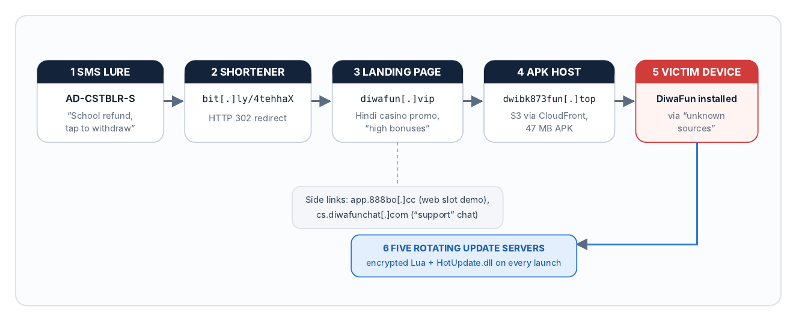
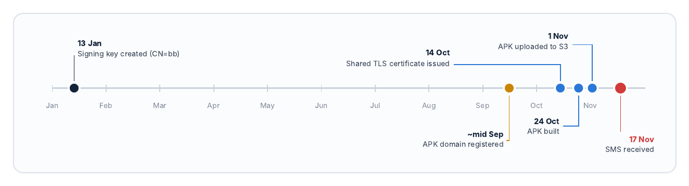
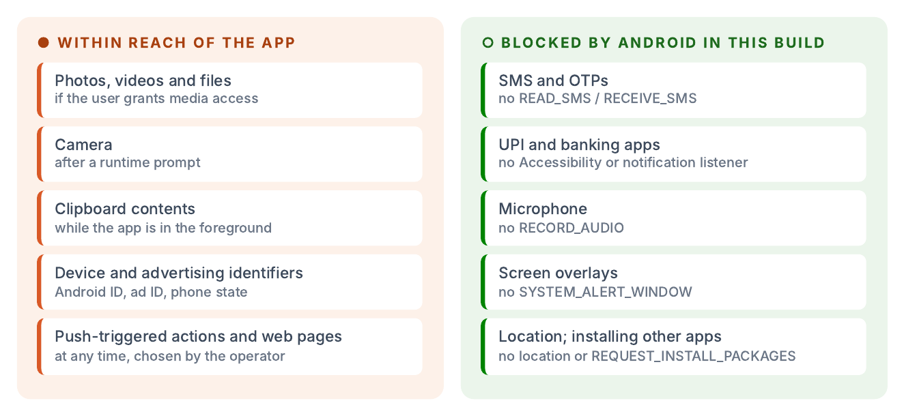
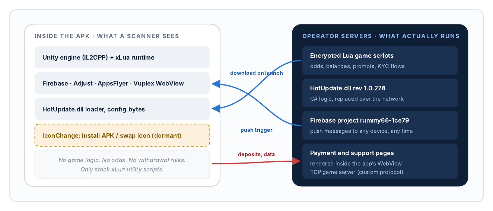
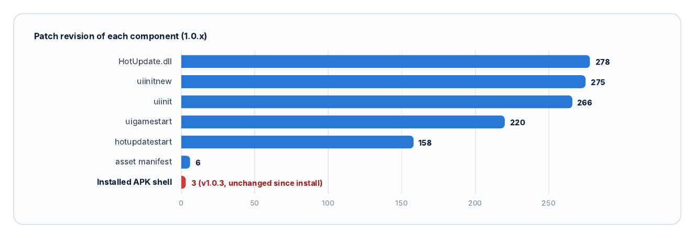
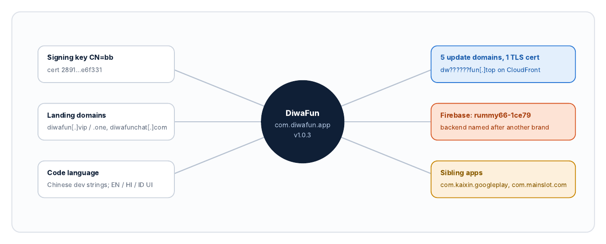
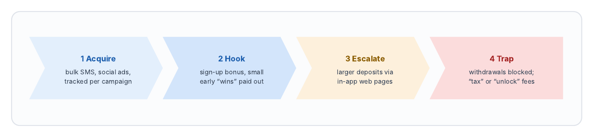
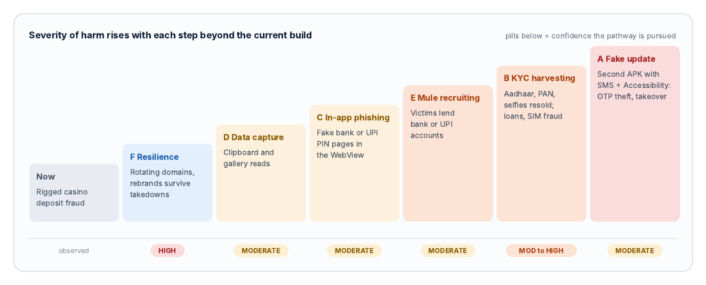

# From a "School Refund" SMS to a Remote-Controlled Casino

### Inside the DiwaFun APK: Static Analysis, Fraud Model and Escalation Paths

*Annanya Sood · 17 November 2026*

---

> **What does it actually cost to tap a link that promises you money?**

📄 **Full report with figures (PDF):** [DiwaFun_APK_Threat_Report_Annanya_Sood.pdf](../assets/pdfs/DiwaFun_APK_Threat_Report_Annanya_Sood.pdf)

| | |
|---|---|
| **Sample** | `com.diwafun.app` v1.0.3 |
| **SHA-256** | `9be2112916a451dbb0ea17ae8015cac6264f15e3f73f00866964df29c88bdbf7` |
| **Method** | Static analysis only. The sample was never installed or executed. |
| **Labels** | **Observed** = evidenced in the sample or third-party scans. **Assessed** = analytic judgement, with a stated confidence. |

---

## I. The Incident

On 17 November 2026 an SMS arrived from a commercial-format sender header, `AD-CSTBLR-S`. It said a school refund was waiting and offered a shortened link to "withdraw" it. The message follows a familiar formula: urgency, money, and a hidden destination. The lure (a school refund) has nothing to do with the payload (a casino). That mismatch is typical of bulk campaigns, which swap stories freely while the destination stays fixed.

Public advisories, including those from CERT-In, have focused on APKs that impersonate challans, bills and bank rewards and then steal OTPs.[^3][^4] This sample arrives the same way but carries a different payload: a gambling platform the operator controls end to end and can reshape after installation.

The link resolved as follows (all URLs defanged):


***Figure 1.** Delivery chain. Once installed, the app keeps pulling its logic from the operator's update servers (step 6).*

| Hop | URL | What it is |
|---|---|---|
| 1 | `hxxps://bit[.]ly/4tehhaX` | URL shortener, HTTP 302 |
| 2 | `hxxps://diwafun[.]vip/?pkg=com.diwafun110.app` | Hindi landing page promoting "DiwaFun" |
| 3a | `hxxps://dwibk873fun[.]top/apps/com.diwafun.app.apk` | APK download on an off-brand domain |
| 3b | `hxxps://app.888bo[.]cc/LandingPage/FortuneGaruda1000-WebGL…` | Browser slot demo |
| 3c | `hxxps://cs.diwafunchat[.]com` | "Customer service" chat |

The landing page advertises slot and crash games (Fortune Gems, Aviator, Super Ace, Lucky Neko) with "high bonuses" and "real rewards". It names no licence and no company, and it publishes no terms, deposit rules or withdrawal rules. Three details suggest the infrastructure was split up deliberately: the page's `pkg` parameter (`com.diwafun110.app`) does not match the package served (`com.diwafun.app`), the APK sits on an unrelated random-looking domain, and the game demo comes from a third domain.

urlscan.io independently downloaded the APK from the live URL and recorded the **same SHA-256**, so the sample analysed here is exactly what victims receive.[^1]

---

## II. Sample Identification

| Attribute | Value |
|---|---|
| File | `com.diwafun.app.apk`, 49,119,280 bytes |
| SHA-256 | `9be2112916a451dbb0ea17ae8015cac6264f15e3f73f00866964df29c88bdbf7` |
| MD5 | `ff4b560ec262fe176b786f15a85fd75c` |
| Version | 1.0.3 (versionCode 1000), minSdk 21, targetSdk 34 |
| Built | 24 October 2026, 10:17 (archive timestamps) |
| Engine | Unity 2019.4.40f1 (IL2CPP), xLua scripting, HybridCLR hot-update layer |
| Launcher | `com.google.firebase.MessagingUnityPlayerActivity` |


***Figure 2.** Campaign timeline (2026): signing key created 13 Jan · APK domain registered ~mid Sep (urlscan: "2 months old") · shared TLS certificate issued 14 Oct · APK built 24 Oct · uploaded to S3 1 Nov · SMS received 17 Nov.*

**Method.** The APK was analysed in an isolated Linux workspace and never installed or executed.

| Stage | Tooling | Purpose |
|---|---|---|
| Delivery chain | HTTP redirect inspection, page retrieval | Resolve the short link, enumerate onward links |
| Package triage | `sha256sum`, `unzip`, Androguard | Hashes, manifest, permissions, components, certificate |
| Dalvik code | Androguard decompiler and cross-references | Custom classes, sensitive API callers, embedded URLs |
| Unity assets | UnityPy | Asset bundles, embedded .NET assemblies, configuration |
| .NET module | dnfile | Types, methods and strings of `HotUpdate.dll` |
| Corroboration | VirusTotal (URL), urlscan.io | Independent download, hash match, hosting and certificate data |

> **Limitation.** The game logic is downloaded at runtime and was not in the sample. Static analysis establishes what the app is **able** to do on a device, not what the operator's scripts **currently** tell it to do. Dynamic analysis in an instrumented sandbox is the natural next step.

---

## III. Static Analysis Findings

### 1. An anonymous signing certificate

```text
Subject : CN=bb, OU=b, O=b, L=b, ST=b, C=bb
Issuer  : CN=bb, OU=b, O=b, L=b, ST=b, C=bb     // self-signed
Serial  : 1
Valid   : 2026-01-13 06:30:19 UTC  to  2051-01-07 06:30:19 UTC
SHA-256 : 28910525ad45f72667a4d92ee1dbd79a66e11cdf86650d0bd55f25f021e6f331
```

**Observed.** Placeholder values, no developer, no organisation. A consumer app that takes money has no legitimate reason to hide who made it. The fingerprint is a durable pivot: any APK signed with this key belongs to the same operator, whatever it is renamed to.

### 2. Permissions: the boundary

| Permission | Use | Risk |
|---|---|---|
| `INTERNET`, `ACCESS_NETWORK_STATE` | Server traffic, hot updates | Baseline |
| `CAMERA` | Photo capture; fits avatar or "KYC" uploads (image cropper bundled) | 🟡 Medium |
| `READ_MEDIA_*`, `READ/WRITE_EXTERNAL_STORAGE` | Gallery and storage, with `requestLegacyExternalStorage=true` | 🟠 High |
| `READ_PHONE_STATE` | Telephony state; tracking SDKs expose IMEI calls | 🟡 Medium |
| `AD_ID`, `ACCESS_ADSERVICES_*` | Advertising ID, attribution | 🟢 Low |
| `RECEIVE_BOOT_COMPLETED`, `WAKE_LOCK` | Background jobs survive reboot | 🟢 Low |
| `POST_NOTIFICATIONS`, C2DM | Firebase push channel | 🟡 Medium |

**Observed absences matter as much.** No `READ_SMS`, `RECEIVE_SMS`, `RECORD_AUDIO`, `SYSTEM_ALERT_WINDOW`, `REQUEST_INSTALL_PACKAGES` or location permissions, and no Accessibility or notification-listener service. Android fixes permissions at install time, so this build **cannot** read SMS or OTPs, record audio, watch UPI or banking apps, or draw overlays, whatever its downloaded scripts say. The manifest also allows unencrypted HTTP (`usesCleartextTraffic="true"`).


***Figure 3.** The permission boundary. Downloaded scripts cannot move anything from the right column to the left.*

### 3. The real application is not in the APK

The package is a thin Unity shell. Its working logic is Lua (run by Tencent's xLua) plus a .NET assembly, `HotUpdate.dll`, replaced over the network. HybridCLR, compiled into the IL2CPP runtime, loads that assembly at run time; the bundled `mscorlib`, `System` and `System.Core` assemblies are its AOT metadata supplements (`LoadMetadataForAOTAssembly`). The bundled config hard-codes five update servers:

```json
{
  "channel": 2010001,
  "version": "1.0.1",
  "gameParam": "all",
  "openLog": false,
  "updateUrls": ["https://dwbvmqfpfun.top/updates",
                 "https://dw0i5qybfun.top/updates",
                 "https://dwibk873fun.top/updates",
                 "https://dwmt1npufun.top/updates",
                 "https://dwd4vuksfun.top/updates"]
}
```


***Figure 4.** Split architecture. Everything a scanner can inspect is generic; everything that decides the user's outcome is downloaded from the operator.*

```text
hotupdatedll,   661e890a60c057120f876787adf41b5d, 282190, 1.0.278
hotupdatestart, fabadda95ac4c075c8f77e19f4c4bf84,   6430, 1.0.158
uigamestart,    f1f544c71ecd4a5eeacbfff8fdb77697,  39342, 1.0.220
uiinitnew,      5d5d6038ae3e0beb7feaa93cb2018f3f,  47228, 1.0.275
```


***Figure 5.** Server-side components have been patched hundreds of times while the installed shell sits at 1.0.3.*

**Observed.** The core module is at revision **1.0.278** while the installed shell is **1.0.3**: hundreds of server-side changes, none reviewed by an app store. No game or business-logic Lua ships in the package. `HotUpdate.dll` contains a `Decrypt` routine, a `LuaDecodeKey` field and the literal `KAIXINGOODLUCK`, which indicates the scripts are encrypted.

> **Implication.** Odds, balances, withdrawal rules, prompts and data-collection flows are defined on the operator's server. They can differ per user, change daily, or switch once a user is flagged. A clean scan of the APK says little about what the app does.

### 4. Network channels

- **Custom TCP transport:** `Networks.HjTcpNetwork` and `HjNetworkBase` implement a raw socket protocol. Chinese developer diagnostics are present, e.g. `服务器没有开启` ("server not started").
- **Embedded browser:** Vuplex WebView renders arbitrary pages in-app, the likely home of deposit pages. A `WebViewTool` type is exposed to Lua.
- **Hosting:** the distribution host sits behind Amazon CloudFront and S3.

### 5. Push notifications as a remote trigger

```text
"fireBase OnTokenReceived Token: "
"fireBase OnMessageReceived from: "
"fireBase OnMessageReceived key: "
"GameMain.OnReceivedMessage(\""    // push payload handed to the Lua entry point
```

**Observed.** Firebase push payloads go straight into the Lua handler `GameMain.OnReceivedMessage`. The operator can make the app open a screen, load a page or start an update flow on demand.

### 6. Dormant capabilities disguised as engine code

The only bespoke Java class identified sits inside Unity's own package namespace, where it passes for engine code:

```java
package com.unity3d.player;          // borrowed namespace
public class IconChange {
  public static boolean CheckAppExist(String pkg)  // is app installed?
  public static boolean DoActiveApp(String pkg)    // launch another app

  public static boolean InstallApk(String path) {
    File f = new File(path);
    if (!f.exists()) return false;
    Intent i = new Intent("android.intent.action.VIEW");
    if (Build.VERSION.SDK_INT < 24) {
      i.setDataAndType(Uri.fromFile(f), "application/vnd.android.package-archive");
      i.setFlags(FLAG_ACTIVITY_NEW_TASK);
    } else {
      i.setFlags(FLAG_GRANT_READ_URI_PERMISSION);
      Uri u = FileProvider.getUriForFile(act, pkgName + ".fileprovider", f);
      i.setDataAndType(u, "application/vnd.android.package-archive");
    }
    act.startActivity(i);                  // hands the APK to the system installer
    return true;
  }

  public static void changeIcon(int which) {   // toggles launcher aliases
    updateAlias(..., new ComponentName(act, "com.unity3d.player.newicon"));
  }
}
```
*Decompiled with Androguard; abridged and lightly renamed for readability.*

**Observed.** The class can check for installed apps, launch them, hand a downloaded APK to the installer, and swap the launcher icon. Its name appears as a string in `HotUpdate.dll`, so server scripts can call it. A further string, `com.mainslot.com.apk`, names a second package this path could deliver.

**Inert, for now.** The manifest lacks the `.fileprovider` authority, the `newicon` alias and `REQUEST_INSTALL_PACKAGES`, so these calls fail on modern Android. A future shell needs only manifest changes to switch them on.

### 7. Tracking, attribution and data access

| Component | Capability |
|---|---|
| Adjust SDK | Attribution to campaign, ad group and creative; Android ID, ad ID; deep links |
| AppsFlyer SDK | Attribution; OneLink invite links; `setCollectIMEI`; `URL_STRATEGY_INDIA` |
| Firebase | Analytics and push |
| Clipboard bridge | `UnityPlayer.getClipboardText()` / `setClipboardText()`, reachable from Lua |
| Native share | Share sheet and `smsto:` invites; lists installed share targets |
| Package visibility | Queries `com.facebook.katana`, `com.instagram.android`, `com.kaixin.googleplay` |

**Observed.** Three overlapping attribution stacks are far more than a casual game needs. They are the hallmark of affiliate-driven acquisition, where every install is credited to a specific SMS blast, influencer or referrer. While the app is open, server scripts can read whatever the user last copied: a UPI ID, an account number, an OTP.

### 8. Attribution indicators


***Figure 6.** Pivot map. Each outer node is an indicator that can be used to find related apps and infrastructure.*

- **Shared backend:** the Firebase project is `rummy66-1ce79`, named after a different gambling brand. This points to a white-label kit reused across brands.
- **Sibling apps:** `com.kaixin.googleplay`, `com.mainslot.com.apk` and a `Kaixin` C# namespace suggest a vendor or operator group called "Kaixin".
- **Targeting:** interface text in English, Hindi and Indonesian ("Game Slot Terbaik"; "सबसे बेहतरीन स्लॉट गेम्स"). The audience is India and Indonesia.
- **Developer language:** Simplified Chinese strings and diagnostics (`复位`, `匀速移动`). This fits outsourced development but does not by itself identify the operator.

### 9. Negative findings

| Capability | Present? | Evidence |
|---|---|---|
| Read SMS / intercept OTPs | ❌ No | No SMS permissions or receivers |
| Watch UPI or banking apps | ❌ No | No Accessibility or notification listener; no UPI intents |
| Record audio | ❌ No | No `RECORD_AUDIO`; `AudioRecord` refs are library code; "StartRecording" is Unity's animation recorder |
| Screen overlays | ❌ No | No `SYSTEM_ALERT_WINDOW` |
| Location | ❌ No | No location permissions |
| Hidden code loading / shell | ❌ No | `Runtime.exec` used only to detect MIUI; no `DexClassLoader` |
| Install further APKs | ⚠️ Dormant | Code present, manifest support absent |

---

## IV. External Corroboration

| Source | Observation (17 Nov 2026) |
|---|---|
| urlscan.io | Live download, matching SHA-256. Host 13.226.238.80 (Amazon CloudFront, AS16509), served from S3. Domain ~2 months old; first scan ever recorded. File last modified 1 Nov 2026.[^1] |
| urlscan.io (TLS) | Certificate issued 14 Oct 2026, subject `dwbvmqfpfun.top`, another of the five update domains. Delivery and update infrastructure are linked. |
| VirusTotal (URL) | **0 / 93** vendors flag the URL.[^2] |

The VirusTotal figure is a verdict on the URL's reputation, not on the file. Zero on a two-month-old throwaway domain is expected and is no assurance of safety.

---

## V. A Strategic Reading: Business Model and Escalation

### Phase 1: deposit fraud (Assessed, high confidence)

The platform is unlicensed and anonymous, and its odds, balances and withdrawal rules live on the operator's server. Platforms of this kind are widely reported to run a four-step cycle:


***Figure 7.** The Phase 1 fraud cycle.*

Because logic is server-side, the operator can treat users differently: pay out promoters to keep testimonials flowing while blocking larger winners. Victims have no regulator to appeal to and no identifiable counterparty.

### Escalation pathways (Assessed)

Each pathway rests on a capability present in the sample. None has been observed in operation.


***Figure 8.** Escalation ladder. Column height shows severity of harm; the pill beneath shows confidence that the pathway is pursued.*

| Pathway | Enabler in the sample | Potential harm | Confidence |
|---|---|---|---|
| **A. Fake "mandatory update"** | Update prompts; dormant `InstallApk`; push trigger; `com.mainslot.com.apk` | Second app with SMS + Accessibility: OTP theft, account takeover | 🟡 Moderate |
| **B. Identity harvesting as "KYC"** | Camera, gallery, image cropper; WebView | Aadhaar, PAN, selfies resold; mule accounts, loans, SIM fraud | 🟠 Moderate to high |
| **C. In-app phishing** | WebView renders any page; push-triggered navigation | Credential or UPI PIN capture on trusted-looking pages | 🟡 Moderate |
| **D. Opportunistic data capture** | Clipboard reads; gallery access | Copied UPI IDs, account numbers, OTPs; payment and ID screenshots | 🟡 Moderate |
| **E. Victim to money mule** | Referral and invite tracking; share tools | Users recruited as "agents" who lend accounts, risking freezes and prosecution | 🟡 Moderate |
| **F. Resilience and rebranding** | 5 rotating domains; shared cert; reused Firebase; anonymous key | Taking down one link or brand changes little | 🔴 High |

### Why pathway A is the critical risk

Downloaded scripts cannot add Android permissions, so the current build has a hard ceiling. That ceiling holds only while the user refuses to install another package. The operator already controls the app's screens, notifications and the timing of every prompt. It is well placed to persuade an engaged user with money at stake to install a "required update" that asks for SMS and Accessibility access, and the user would grant both, trusting an app they already use.

> **Assessment.** The most serious long-term risk is not what this APK does today. It is the trusted, remotely steerable channel it opens onto the victim's phone, a channel that can later deliver conventional banking malware with the victim's own cooperation.

---

## VI. The Detection Gap

Three properties defeat signature- and reputation-based defences:

- **Disposable infrastructure.** Fresh `.top` domains on reputable cloud hosting have no history, hence 0/93.
- **A benign-looking package.** Mostly legitimate SDKs; the one bespoke class poses as engine code.
- **Logic delivered later.** Whatever would trigger detection is downloaded after install, encrypted, and can differ per user.

Defence has to move from scanning files to judging context. An unexpected refund that requires installing an app is a scam, whatever any scanner reports.

---

## VII. Recommendations

**For individuals**
- Never install APKs from SMS, WhatsApp or Telegram links. Keep "Install unknown apps" off.
- If installed: uninstall. Never accept an in-app update that downloads a file. Don't deposit money or upload ID.
- If you can't uninstall right away, revoke camera and photo access first.
- Report the SMS on Sanchar Saathi (Chakshu). Report losses or exposed documents on **1930** or cybercrime.gov.in, and tell your bank.[^5]

**For platforms and responders**
- Report the five update domains and the distribution domain to the `.top` registry and registrar, and the S3/CloudFront hosting to AWS.
- Report Firebase project `rummy66-1ce79` to Google. Disabling it cuts the push channel for every brand that shares it.
- Hunt by certificate fingerprint, the `KAIXINGOODLUCK` string, the `IconChange` class, and the domain pattern `dw[a-z0-9]{6}fun.top`.
- Trace `AD-CSTBLR-S` through TRAI DLT records to the entity that registered it.

---

## VIII. Conclusion

We began by asking what it costs to tap a link that promises money. Here the answer is not an emptied bank account, at least not immediately: this APK does not steal OTPs. The cost is quieter and lasts longer. Tapping the link installs a channel run by an anonymous operator, whose behaviour is written after installation and can be rewritten without notice. It is built first to take deposits and then, potentially, to talk the user into installing something far worse.

The sample is an example of a pattern defenders should expect more often: lightweight, legitimate-looking shells whose harm lives on the server. They pass reputation checks, rotate infrastructure faster than blocklists follow, and rely on the victim's own trust to escalate.

---

## Appendix: Indicators of Compromise

All network indicators are defanged. The APK itself is deliberately **not** hosted in this repository.

| Type | Indicator | Context |
|---|---|---|
| SHA-256 | `9be2112916a451dbb0ea17ae8015cac6264f15e3f73f00866964df29c88bdbf7` | DiwaFun APK v1.0.3 |
| MD5 | `ff4b560ec262fe176b786f15a85fd75c` | DiwaFun APK v1.0.3 |
| Cert SHA-256 | `28910525ad45f72667a4d92ee1dbd79a66e11cdf86650d0bd55f25f021e6f331` | Signing cert (CN=bb) |
| Package | `com.diwafun.app`, `com.diwafun110.app` | Served / landing-page parameter |
| Package | `com.kaixin.googleplay`, `com.mainslot.com` | Related or referenced |
| URL | `hxxps://bit[.]ly/4tehhaX` | SMS link |
| Domain | `diwafun[.]vip`, `diwafun[.]one`, `diwafunchat[.]com` | Landing, preview image, support chat |
| Domain | `dwibk873fun[.]top` | APK distribution and update host |
| Domain | `dwbvmqfpfun[.]top`, `dw0i5qybfun[.]top`, `dwmt1npufun[.]top`, `dwd4vuksfun[.]top` | Hot-update hosts |
| Domain | `app.888bo[.]cc` | Web slot demo |
| IP | `13.226.238.80`, `54.192.35.3` | CloudFront edges (shared CDN, low fidelity) |
| Firebase | `rummy66-1ce79`, sender `283980955957` | Push and analytics backend |
| String | `KAIXINGOODLUCK` | Lua decode key in HotUpdate.dll |
| Class | `com.unity3d.player.IconChange` | Bespoke installer / icon-swap class |
| Sender | `AD-CSTBLR-S` | SMS header used in the lure |

---

## Appendix: Embedded Component Inventory

| Component | Location | Notes |
|---|---|---|
| Unity runtime (IL2CPP) | `lib/*/libunity.so`, `libil2cpp.so` | Unity 2019.4.40f1 |
| HybridCLR | `lib/*/libil2cpp.so` | Runtime loader for hot-update .NET assemblies |
| xLua (Tencent) | `lib/*/libxlua.so` | Lua VM bridging scripts and C# |
| HotUpdate.dll | `assets/hotupdatedll` | 1.4 MB .NET assembly; 638 types; Kaixin, Networks, XLua namespaces |
| HotGameUpdate.dll | `assets/hotgameupdatedll` | 7 KB loader stub |
| Vuplex WebView | `lib/*/libVuplexWebViewAndroid.so` | In-app browser |
| Firebase C++ 11.9.0 | `lib/*/libFirebaseCpp*.so` | App and Messaging |
| Adjust, AppsFlyer | `classes.dex` | Attribution SDKs |
| NativeShare, NativeGallery | `com.yasirkula.unity` | Share sheet and gallery access |

---

## References

## Footnotes

[^1]: urlscan.io, scan of `hxxps://dwibk873fun[.]top/apps/com.diwafun.app.apk`, 17 November 2026 (author's submission).
[^2]: VirusTotal, URL report for `hxxps://dwibk873fun[.]top/apps/com.diwafun.app.apk`, 17 November 2026.
[^3]: CERT-In alert on APK malware spread through fake e-challan and bill messages, as reported by the *Free Press Journal*. https://www.freepressjournal.in/mumbai/cert-in-issues-alert-on-apk-malware-fraud-used-by-cybercriminals-to-steal-financial-data-via-fake-e-challan-bill-alerts
[^4]: *Moneylife*, "Fraud Alert: From e-Challan, Gas Bill Updates to APK Traps." https://www.moneylife.in/article/fraud-alert-why-seniors-are-in-the-crosshairs/article/fraud-alert-from-echallan-gas-bill-updates-to-apk-traps-how-malware-scams-are-draining-bank-accounts/79996.html
[^5]: Department of Telecommunications, *Sanchar Saathi* awareness material. https://sancharsaathi.gov.in/SancharSaathiDocuments/KeepYourselfAwareDocuments/InvestmentScam.pdf
